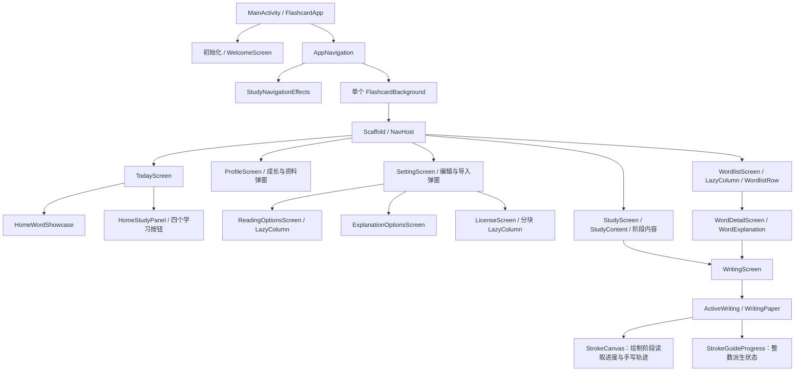

# Compose 性能分析与优化记录

日期：2026-10-13。性能采样基于当时的实际工作区，保留此前的功能、资源和数据库改动。应用版本保持 `1.4.0 / 6`；本分析先于发布完成，后续整合提交、推送及签名 Release 的验证见 [版本日志](../VERSIONLOG.md)。

## 结果与证据

已定位并处理三类问题：过宽的状态订阅和参数传递、动画值在组合阶段读取、重复绘制与长页面一次构建。手机已覆盖安装去掉临时探针的最终 Debug APK；17:43 已确认回到首页，系统、铃声、媒体、通知音量均为 0，之后停止手机操作。

全量重新编译生成六个 Compose 模块的编译器报告，得到 141 个具名声明，其中 22 个名字含 Preview、119 个非预览声明。后者包含资源函数和样式访问器，不能理解为 119 个页面。所有导航页面及其主要状态、子树、弹窗均在下面列出。

最明确的运行证据是重组范围缩小。临时诊断通过 Compose `CompositionTracer` 统计项目函数体执行，包含初次组合和重组，不统计被跳过的函数；这些数值不是布局次数、绘制次数或整个 Compose 树的节点数。诊断源码与入口已移除，最终 APK 的 DEX 中不存在该探针。

| 相同操作 / 函数 | 优化前执行次数 | 优化后执行次数 | 说明 |
| --- | ---: | ---: | --- |
| 首页换词 4 次：AppNavigation | 4 | 0 | 换词不再使导航根节点执行 |
| 首页换词 4 次：HomeStudyPanel | 4 | 0 | 学习面板只接收自身使用的状态 |
| 首页换词 4 次：HomeActionButton 合计 | 16 | 0 | 四个学习按钮保持原有子树 |
| 首页换词 4 次：HomeWordShowcase | 4 | 4 | 词汇内容确实变化，应更新 |
| 笔顺播放约 4 秒：ActiveWriting | 156 | 1 | 动画状态不再在上层按帧读取 |
| 同上：WritingPaper | 156 | 1 | 固定纸面与标题保持原有组合 |
| 同上：StrokeCanvas | 156 | 1 | 动画值在绘制回调中读取 |
| 同上：StrokeGuideProgress | 原来内联在 ActiveWriting | 5 | 仅显示的整数笔画数变化时组合 |

词库快速滑动的采样中，优化前后 `WordlistScreen` 与 `WordlistContent` 均为 0 次执行；`WordlistRow` 分别执行 42、53 次。滑动距离和新进入视口的词条数量不同，不能把 53 解读为回归，也不能把所有行的初次组合称为“不必要刷新”。朗读设置首次进入仅构建 3 个场景卡片，随后向下滑动构建其余 7 个；该滑动期间 `ReadingOptionsScreen` 与 `OptionsPage` 为 0 次执行。

## 帧率与帧耗时

设备为已连接 Android 手机 `23127PN0CC`，分辨率 1200×2670。系统最高刷新率设置为 120 Hz，实际采样 `FrameInterval` 约 16.63 ms，显示服务也报告约 60 Hz；本轮不能证明 120 Hz 下的表现。

使用 `dumpsys gfxinfo ... framestats`，每次动作前重置，分别保存点击导航、换词、120 ms 快滑、650 ms 普通滑动和笔顺播放记录。原始文件保存在仓库外的本轮临时证据目录。下面对比采用两份带相同函数计数探针的 Debug 版本；另采集过无探针的优化前版本。遵照用户停止手机测试的要求，最终无探针版本安装后未再进行完整帧率复测。

| 采样场景 | 优化前 P50 / P95 帧总耗时 | 优化后 P50 / P95 | 渲染节奏估计：前 → 后 |
| --- | --- | --- | --- |
| 笔顺播放，各取 119 个有效记录 | 23.28 / 32.78 ms | 14.54 / 26.84 ms | 36.4 → 59.7 帧/秒 |
| 普通词库滑动，65 / 68 个记录 | 13.37 / 22.00 ms | 12.49 / 17.73 ms | 49.3 → 53.7 帧/秒 |
| 第 5 次词库快滑，56 / 63 个记录 | 14.15 / 32.36 ms | 13.23 / 27.55 ms | 58.2 → 56.5 帧/秒 |

帧总耗时为 `FrameCompleted - IntendedVsync`；渲染节奏估计取连续记录的 IntendedVsync 间隔，排除超过 250 ms 的空闲间隔。它反映渲染记录的节奏，不是经过 SurfaceFlinger 展示时间验证的屏幕实呈帧率。framestats 是有限环形缓冲区，119 个记录并不覆盖笔顺播放的完整 4 秒；前后采样只用于定位和观察趋势，不能当成多轮严格基准。

计时纳入 RenderThread 动画记录，排除窗口可见性变化及已跳过帧的标记；设备还出现厂商标记 32，该标记保留在原始记录中。设备的 FrameDeadline 曾出现远大于一帧的预算，因此不采用脚本初始输出的“deadline miss = 0”作为流畅证明。以上数据仍存在超过 16.67 ms 的帧，首轮进入词库也存在耗时尖峰；不能宣称所有卡顿消失。导航点击包含水波纹等持续绘制，帧记录数量也不能直接等同于转场时长。

## 页面与状态层级

层级图省略了标准 Row、Column、Surface 内部的 Material/布局节点。不能通过少一层容器就推断性能提升：是否频繁读取状态、是否需要重新测量、子节点能否跳过、绘制与语音工作量更重要。

| 页面 / 路由 | 主要层级 | 状态来源与触发范围 | 频率、处理与覆盖 |
| --- | --- | --- | --- |
| 初始化 | FlashcardApp → Surface → Loading / Error | StartupViewModel 的 ready、busy、error、settings；加载进度由 WordlistLoadingProgress 自己订阅 | 初始化结果更新页面；进度不提升到导航根。启动与最终首页已观察；未重建空库或模拟导入失败 |
| 欢迎页 | WelcomeScreen → 当前步骤 → 名字 / 头像 / Slider / 复习日 | 本地 rememberSaveable，最终保存才进 Repository | 输入与离散选择更新当前步骤；不按输入事件写库。完整源码分析，未重置手机 welcomed 状态 |
| 导航与主题 | AppNavigation → Language / Explanation / Theme provider → Background → Scaffold / NavHost | 只在根节点读取 studyBusy、stage 的 derivedStateOf；详细卡片与换词状态在 StudyNavigationEffects 中读取 | 路由、忙碌、语言、阶段、主题仍可更新根；换词不更新根。配置改变带来的全局失效属于必要更新 |
| 首页 today | TodayContent → Header / Showcase / StudyPanel | StudyUiState 汇聚；Showcase 接收词条、加载与错误；Panel 接收 today、card、busy、error | 首页容器换词仍执行，学习子树可以跳过。换词、入口、阶段菜单与语言弹窗已操作 |
| 学习 study：INTRO / EXPLANATION | StudyScreen → StudyContent → PageColumn → 词头 / WordMeanings / WordExplanation | VM 卡片、操作状态；例句、分区选择与展开由内容组件本地持有 | 卡片阶段切换是必要更新，例句切换不修改学习记录。讲解与回首页已操作；INTRO 为源码分析 |
| 学习 study：QUESTION / FEEDBACK | 同一 Scaffold：固定工具栏与底栏；内容含 QuestionHeading、QuestionExample、最多四个 LanguageOption、AnswerFeedback | 答题保存、正确答案揭示、语音完成等离散本地状态；busy 保护重复输入 | 一次正确答案及再次点击，经历 QUESTION → FEEDBACK → EXPLANATION；StudyScreen / StudyContent 各 6 次执行。不同状态可能在同一帧合并，不能把 StateFlow 发射数当成重组次数 |
| 学习 study：WRITING / FINISHED | 写字导航占位 / 完成统计 + StudyCompletionEffects | 写字 session claim、完成条件、一次性庆祝标记 | 完成粒子 progress 改为只在 Canvas 绘制回调读取。完整源码与编译验证；未通过完成整套学习来触发庆祝 |
| 词库 wordlist | WordlistContent → LazyColumn → 一个 Header / 筛选 / WordlistRow | VM 的查询、筛选、统计、entries；滚动由 LazyListState 持有 | 查询与归一化原本已在 Default，原有取消与 generation 保留。条目 key 保留，补充 contentType；滚动结束与离开时保存位置，不按像素更新 VM。滑动与条目点击已操作 |
| 词条 word/{wordId} | WordDetailContent → Scaffold → WordHeading / Meanings / Explanation | 条目载入、bookmark/skip、busy；展开与示例选择本地化 | 自动朗读 claim 与写字 request 消费规则保留。词条进入、讲解、写字与返回已操作；未更改收藏或跳过标记 |
| 写字 writing/{id}、word-writing/{id} | WritingScreen → ActiveWriting → Paper / Canvas / Toolbar / Caption | VM 仅在加载、提交完整一笔、撤回、重启、保存结果时更新；逐点轨迹留在 Canvas | 帧进度通过 lambda 下沉，withFrameNanos 按真实时间推进；遵守动画缩放，暂停/离开停止。播放与暂停、详情写字返回已操作；未提交手写笔画或覆盖完整存储失败链路 |
| 个人 profile | ProfileScreen → identity / LevelBadge / Metric / GrowthDetails → 编辑或说明弹窗 | ProfileUiState；编辑器与成长说明开关在页面本地 | 无每帧数据源，不为静态统计卡片强加 Lazy。成长说明、头像选择、真实头像网格滑动与取消已操作；名字编辑为源码分析 |
| 设置 settings | SettingScreen → Sections / SettingsRow → SettingDialog | ProfileUiState、CsvImportUiState；编辑草稿在弹窗 rememberSaveable，保存才写库 | 主题/语言/词数/轮数/复习日草稿变化仅作用于弹窗；导入进度有独立组件。页面滚动、主题弹窗取消已操作；导入与其余编辑器为源码分析 |
| 朗读 reading-options | OptionsPage → LazyColumn → SceneCard → 四个模式 | stored.speechOptions、learningLanguage、saving；每个卡片只接收 scene、selected、enabled | 10 场景按可见项构建，有 key/contentType；保存指示放入工具栏，不插入列表顶部推动内容。首屏与滚动到底已观察；未改写用户朗读偏好 |
| 讲解 explanation-options | OptionsPage → LazyColumn → 一个四项选择卡片 | stored.explanationOptions 的四个布尔值、saving | 选项只有四项，保持为一张卡；保存通过 VM。Literal breakdown 关闭再恢复，最终四个选项均选中 |
| 许可 licenses | LicenseScreen → LazyColumn → Intro / status / 文本块 | produceState 在 IO 读取固定本地资源，一次结果更新 | 原先一次测量 71,408 字符，改为按原段落边界生成 17 块，最大 5,634 字符；拼接与原文完全相同。优化前页面已操作，最终优化编译通过；最终分块页面未再占用手机复测 |

## 弹窗与共用组件

| 组件 | 状态与层级结论 |
| --- | --- |
| LanguagesDialog / LanguageChoices | 两个语言草稿与 savedRevision；仅确认后保存。切换学习语言的 generation 与旧回调保护保持原有实现 |
| StagePicker | expanded 本地化，五个阶段菜单项；打开关闭不写学习状态，选择才调用 VM。未改变阶段或学习计划 |
| AvatarPickerDialog / PresetAvatar / EditableAvatar | draftId 本地化，LazyVerticalGrid 已有稳定 id；点击更新选择边框，可见头像按需绘制，保留图标缓存与资源 |
| Name / DailyWords / Rounds / ReviewDays / Theme / Language Dialog | rememberSaveable 草稿，输入合法性和 saving 控制确认按钮；本地点击不应引起持久化同步刷新 |
| CsvImportDialog | 最多展示前 100 条问题，进度独立订阅。100 条问题的 eager Column 是后续需导入大错误集才能量化的候选；本轮未执行文件导入 |
| GrowthInfoDialog / GrowthDetails / LevelBadge | 本地开关与持久化成长统计，图标按 drawable 复用；没有连续动画状态源 |
| WordExplanation / WordExamplePanel / QuestionExample | 分区、示例编号、展开为局部状态；记忆 key 包含词条/例句/偏好。答题前仍只恢复目标语言内容，不揭示对照答案 |
| WordUserActions / SkipConfirmationDialog | 收藏或跳过调用原 VM；确认开关本地持有，busy 和卡片阶段限制保留 |
| PageColumn / DailyProgress / RoundProgress | scrollKey 改变才回顶部；进度数值采用 indicator 的 lambda；不把像素滚动状态传给父页面 |
| FlashcardBackground / glassPanel | 导航统一一个固定背景；子页面 modifier 检测背景已绘制后直接复用，单页 Preview 保留自己的背景。保留现有缓存 RenderNode 模糊、玻璃边缘与阴影，没有对内容做截图模糊 |
| AppLanguageProvider / uiString / uiPlural | 保留设备字体、密度和局部语言资源；纯资源读取包装加 ReadOnlyComposable，减少冗余组合分组，不给 List/Map 模型冒加 Immutable |

## 编译器报告核对

重新执行完整任务，避免增量编译只输出被改文件的局部报告。Kotlin 2.2.10 的 strong skipping 能让含不稳定参数的可重启组件仍然可跳过，但不稳定对象主要按引用比较；不能因此认为所有集合稳定或所有组件都会跳过。

| 模块 | 具名非 Preview 声明 | 总 Compose 函数（含匿名） | restartable | skippable | memoized / total lambdas |
| --- | ---: | ---: | ---: | ---: | ---: |
| app | 5 | 40 | 40 | 24 | 95 / 95 |
| core/ui | 38 | 139 | 124 | 84 | 93 / 93 |
| feature/study | 32 | 154 | 151 | 95 | 179 / 179 |
| feature/profile | 25 | 139 | 137 | 81 | 138 / 138 |
| feature/wordlist | 8 | 53 | 52 | 30 | 64 / 64 |
| feature/writing | 11 | 47 | 47 | 33 | 53 / 53 |

skippable 不等于“未执行”，不可重启的返回值函数、匿名 slot、布局和绘制也不能按该表相加后当成页面重组次数。运行记录证明了换词和播放的具体范围；未实际触发的欢迎、导入失败、学习完成、错误反馈等路径仅有静态与编译证据。

## 本轮实现与验证

仅追加本轮性能改动到以下九个业务文件，未覆盖工作区原有修改：

- `app/.../FlashcardApp.kt`：缩小根状态读取；详细导航副作用单独成组；单一背景；180/120 ms 淡入淡出；重复目的地点击保护；词库 VM 延后到首次进入但仍使用共享 owner；页面对应的英语预热；许可分块懒加载。
- `core/ui/.../FlashcardBackground.kt`：导航背景复用与 Preview 退化路径。
- `core/ui/.../Localization.kt`：纯资源读取声明。
- `core/media/.../OfflineSpeech.kt`：预热等待 220 ms，快速替换页面可在进入原生模型运算前取消；实际朗读与原有超时、回退和缓存逻辑保持。
- `feature/study/.../TodayScreen.kt`：首页展示与学习面板参数按实际用途分开。
- `feature/study/.../StudyFeedbackEffects.kt`：粒子进度在绘制阶段读取。
- `feature/profile/.../ReadingOptionsScreen.kt`：按场景懒加载，独立卡片，保存状态不推动列表。
- `feature/wordlist/.../WordlistScreen.kt`：条目类型复用与结束滚动时记位置。
- `feature/writing/.../WritingScreen.kt`：按帧推进、绘制读取、整数进度、复用笔画路径与暂停生命周期。

执行 `:app:assembleDebug :app:lintDebug --rerun-tasks` 并通过：0 错误、14 条依赖/SDK 类原有警告。没有新增测试代码，没有运行单元或仪器化用例；lint 分析测试变体并不代表执行了测试。

最终无探针 Debug APK SHA-256：`43e070666c1e64cbcfe958420975f0532c312e6a01dece8ea52506056cfa8200`。ADB 覆盖安装返回 Success，应用启动并确认首页。`MainActivity.kt` 恢复到本轮开始时的相同字节内容。构建报告、原始帧记录、函数计数、工作区基线与私有数据库备份留在仓库外，不加入 Git。

冻结 `wordlist.csv` SHA-256 仍为 `21b2dbf3103513c8b1749a5f2cfc17a94f7df3f9ca63f89748d4f9718a9388a7`，版本、迁移、词库与学习算法未因性能修改而改变。设备测试在原有学习词条上完成一次正确答案，未完成整词学习；手动写字入口用于播放测试，未提交笔画。讲解偏好已恢复，语言、阶段、主题和朗读偏好未另行修改。

安全自查：本轮最终 diff 未新增网络接口、权限、依赖、秘密或敏感日志；原有持久化锁、上下文 generation、防重复写入和输入上限保持；临时诊断已从正式工作区与最终 APK 移除。

## 仍未证明的部分

快滑与首次进入依然有超过帧预算的记录，GPU 模糊/阴影、文字首次测量、JIT 与语音原生运算仍是后续可测的候选；本轮不会把它们都归因于 Compose 重组。最终预热限制、资源读取和许可分块已编译并安装，但按用户时间要求没有再进行最终无探针、多轮或 Release 基准。未覆盖 120 Hz 实呈帧率、不同设备、大字体完整回归、真实手写保存失败、学习完成庆祝、CSV 导入或语音音质。

方法参考：[Compose 性能最佳实践](https://developer.android.com/develop/ui/compose/performance/bestpractices)、[Strong skipping](https://developer.android.com/develop/ui/compose/performance/stability/strongskipping)、[组合追踪与测量条件](https://developer.android.com/develop/ui/compose/tooling/tracing)、[AOSP 帧记录标记](https://github.com/aosp-mirror/platform_frameworks_base/blob/master/libs/hwui/FrameInfo.h)。上述资料说明测量和优化方法，具体结果以本轮源码、报告和设备记录为准。
